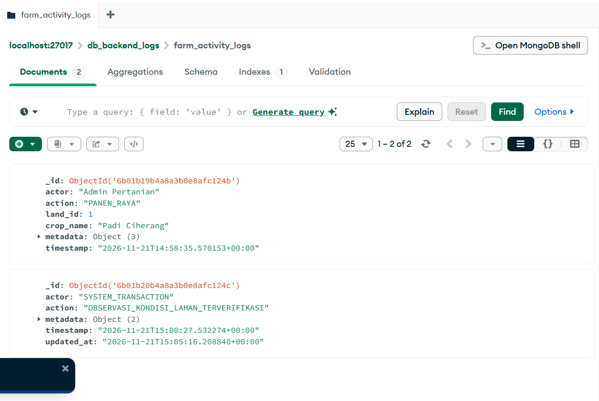
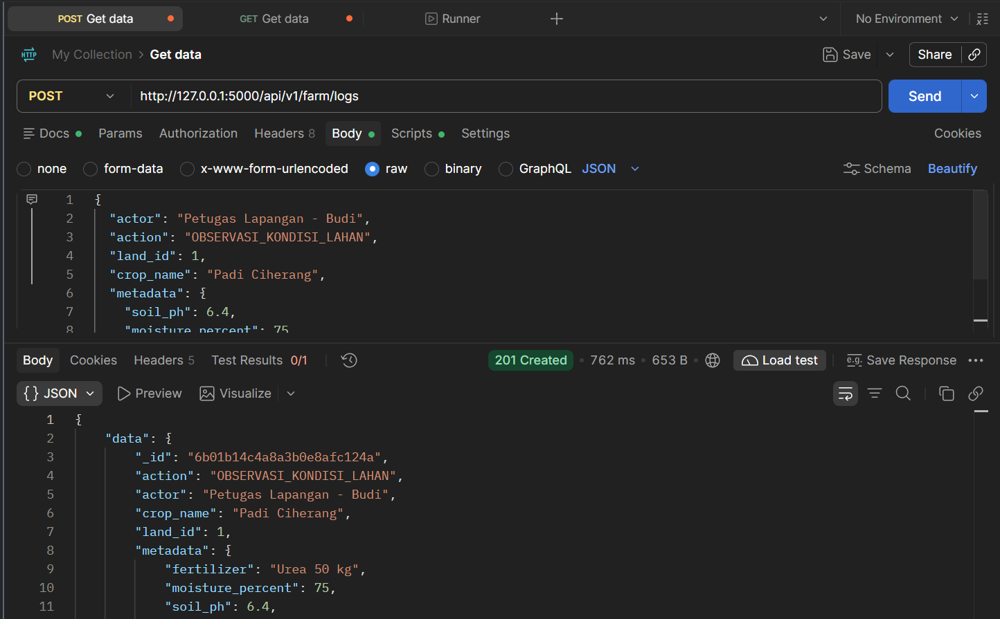
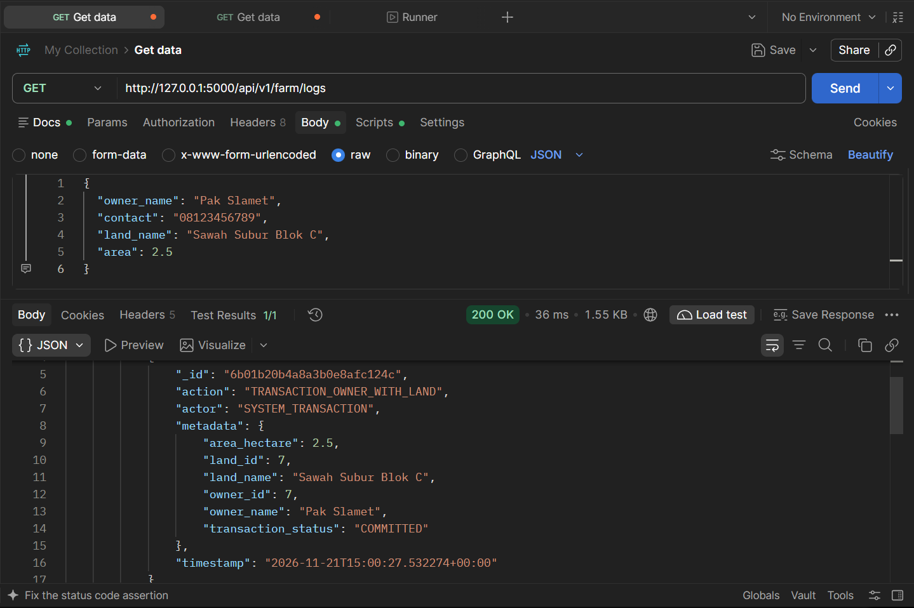
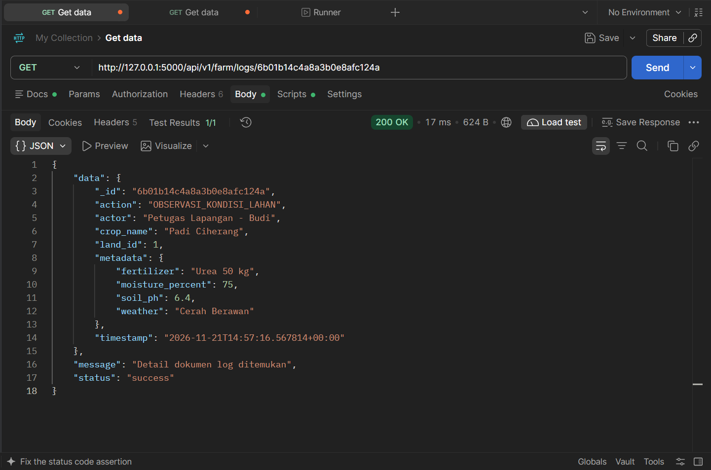
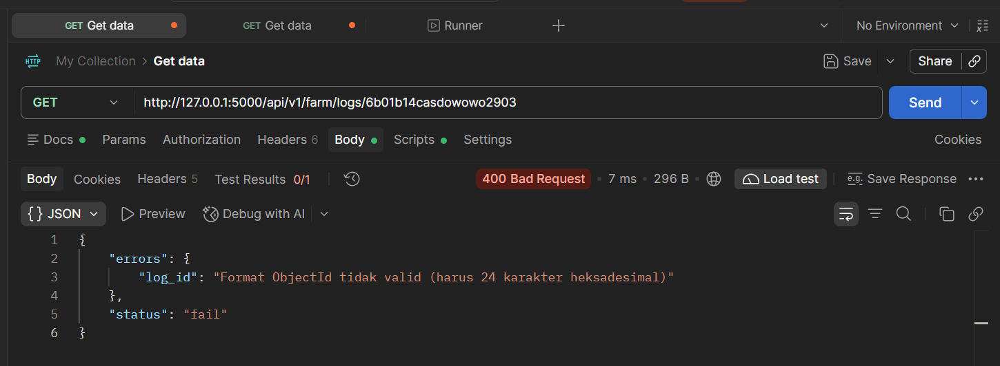
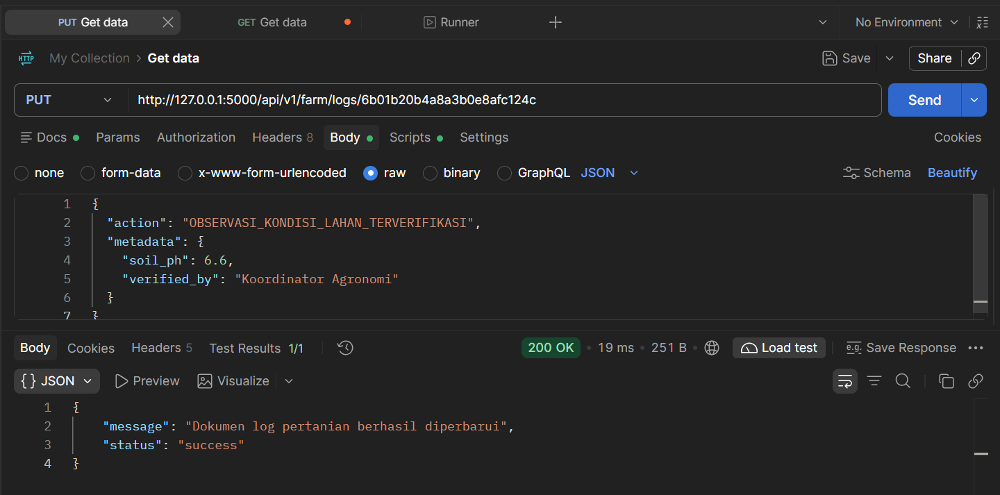
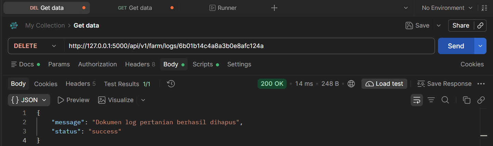

#  Farm Management System - Backend API (Polyglot Persistence: MySQL + MongoDB)

Sistem Manajemen Data Lahan dan Tanaman Pertanian (*Farm Management System*) berbasis RESTful API. Proyek backend ini merupakan lanjutan dari proyek UTS dengan mengimplementasikan arsitektur **Polyglot Persistence**—memadukan **MySQL (SQLAlchemy)** untuk data master relasional dan transaksi atomik (ACID Compliance), serta **MongoDB (PyMongo)** untuk pencatatan log aktivitas lapangan (*Embedded Document*) dan *Audit Trail* transaksi lintas basis data.

---

##  Teknologi & Stack
* **Language**: Python 3.x
* **Framework**: Flask (Application Factory Pattern & Blueprints)
* **Relational Database (RDBMS)**: MySQL via SQLAlchemy (`PyMySQL` driver) — `db_uts_backend`
* **NoSQL Document Store**: MongoDB via `PyMongo` & `bson` — `db_backend_logs`
* **Architecture**: Layered Architecture (`Model -> Repository -> Service -> Route`) + Modular Blueprints
* **API Standard**: JSON Response Envelope (`success`, `fail`, `error`) & UTC-Aware ISO-8601 Timestamps

---

##  Struktur Direktori Proyek

```text
praktikum 9/
├── app/
│   ├── models/
│   │   ├── owner.py                # ORM Model MySQL - Owner
│   │   ├── land.py                 # ORM Model MySQL - Land (Relasi 1:N ke Owner)
│   │   └── crop.py                 # ORM Model MySQL - Crop (Relasi 1:N ke Land)
│   ├── repositories/
│   │   ├── owner_repository.py     # Data Access Layer - Owner
│   │   ├── land_repository.py      # Data Access Layer - Land
│   │   └── crop_repository.py      # Data Access Layer - Crop
│   ├── services/
│   │   ├── owner_service.py        # Business Logic & Validation - Owner
│   │   ├── land_service.py         # Business Logic & Validation - Land
│   │   └── crop_service.py         # Business Logic & Validation - Crop
│   ├── routes/
│   │   ├── owner_routes.py         # Controller Endpoint CRUD Owner (MySQL)
│   │   ├── land_routes.py          # Controller Endpoint CRUD Land (MySQL)
│   │   ├── crop_routes.py          # Controller Endpoint CRUD Crop (MySQL)
│   │   ├── advanced_routes.py      # Transaksi ACID MySQL + Auto Audit Trail MongoDB
│   │   └── mongo_log_routes.py     # Controller CRUD Lengkap NoSQL MongoDB
│   ├── utils/
│   │   └── response_helper.py      # JSON Response Envelope Formatter
│   ├── __init__.py                 # Application Factory (`create_app`)
│   └── config.py                   # Konfigurasi Terpusat MySQL & MongoDB
├── screenshots/
│   ├── 01_compass_farm_logs.png        # Bukti Koleksi Dokumen di MongoDB Compass
│   ├── 02_postman_post_create.png      # Bukti POST Create Log
│   ├── 03_postman_post_audit_trail.png # Bukti Audit Trail Otomatis
│   ├── 04_postman_get_detail.png       # Bukti GET Detail ObjectId
│   ├── 05_postman_get_invalid_id.png   # Bukti Validasi InvalidId (400)
│   ├── 06_postman_put_update.png       # Bukti PUT Update ($set)
│   └── 07_postman_delete.png           # Bukti DELETE Dokumen
├── requirements.txt                # Daftar Dependensi Python (`flask`, `pymongo`, dll.)
├── run.py                          # Application Entry Point
└── README.md                       # Dokumentasi Proyek
```

---

##  Fitur Utama

1. **Full CRUD Operations (3 Entitas Relasional MySQL)**:
   * **Owners** (Pemilik Lahan)
   * **Lands** (Lahan Pertanian, Relasi 1:N ke Owner)
   * **Crops** (Tanaman Komoditas, Relasi 1:N ke Land)
2. **Server-Side Pagination & Search**:
   * Paginasi berbasis `page` & `per_page` serta pencarian *case-insensitive* menggunakan `.ilike()`.
3. **Advanced Multi-Table Transaction (ACID) + Event-Driven Audit Trail**:
   * Penambahan data Owner dan Land secara simultan pada MySQL (`db.session.flush()`, `commit()`, `rollback()`).
   * Setiap transaksi berhasil (`COMMITTED`) maupun gagal (`ROLLBACK`) otomatis dicatat ke koleksi `farm_activity_logs` di MongoDB.
4. **NoSQL Document Modeling & Full CRUD (`PyMongo`)**:
   * Penyimpanan log aktivitas pertanian & observasi lapangan menggunakan **Embedded Document** (`metadata` dinamis / *schema-less*).
   * Serialisasi aman BSON `ObjectId` ke `str` serta validasi format `InvalidId` (HTTP `400 Bad Request`).
   * Pembaruan dokumen secara parsial dan atomik menggunakan operator `$set`.

---

##  Daftar Endpoint API

### 1. Owners — MySQL (`/api/v1/farm/owners`)
| Method | Endpoint | Description |
| :--- | :--- | :--- |
| `GET` | `/api/v1/farm/owners` | Ambil daftar pemilik (Pagination & Search `?search=...`) |
| `POST` | `/api/v1/farm/owners` | Tambah data pemilik baru |
| `PUT` | `/api/v1/farm/owners/<id>` | Perbarui data pemilik berdasarkan ID |
| `DELETE` | `/api/v1/farm/owners/<id>` | Hapus data pemilik berdasarkan ID |

### 2. Lands — MySQL (`/api/v1/farm/lands`)
| Method | Endpoint | Description |
| :--- | :--- | :--- |
| `GET` | `/api/v1/farm/lands` | Ambil seluruh daftar lahan (Pagination & Search) |
| `POST` | `/api/v1/farm/lands` | Tambah data lahan baru (`owner_id` required) |
| `PUT` | `/api/v1/farm/lands/<id>` | Perbarui data lahan berdasarkan ID |
| `DELETE` | `/api/v1/farm/lands/<id>` | Hapus data lahan berdasarkan ID |

### 3. Crops — MySQL (`/api/v1/farm/crops`)
| Method | Endpoint | Description |
| :--- | :--- | :--- |
| `GET` | `/api/v1/farm/crops` | Ambil seluruh data tanaman komoditas |
| `POST` | `/api/v1/farm/crops` | Tambah data tanaman baru (`land_id` required) |
| `PUT` | `/api/v1/farm/crops/<id>` | Perbarui data tanaman berdasarkan ID |
| `DELETE` | `/api/v1/farm/crops/<id>` | Hapus data tanaman berdasarkan ID |

### 4. Advanced Transaction & Audit Trail — MySQL + MongoDB (`/api/v1/farm/advanced`)
| Method | Endpoint | Description |
| :--- | :--- | :--- |
| `POST` | `/api/v1/farm/advanced/owner-with-land` | Buat Owner & Land sekaligus dalam 1 transaksi atomik + simpan log audit otomatis ke MongoDB |

### 5. Farm Activity & Observation Logs — NoSQL MongoDB (`/api/v1/farm/logs`)
| Method | Endpoint | Description |
| :--- | :--- | :--- |
| `GET` | `/api/v1/farm/logs` | Ambil maksimal 20 dokumen log pertanian terbaru (urut waktu) |
| `GET` | `/api/v1/farm/logs/<string:log_id>` | Ambil detail 1 dokumen log berdasarkan 24-hex `ObjectId` |
| `POST` | `/api/v1/farm/logs` | Simpan dokumen log baru dengan *Embedded Document* `metadata` |
| `PUT` | `/api/v1/farm/logs/<string:log_id>` | Perbarui sebagian atribut dokumen menggunakan operator `$set` |
| `DELETE` | `/api/v1/farm/logs/<string:log_id>` | Hapus dokumen log berdasarkan `ObjectId` |

---

##  Contoh Request & Response JSON (Modul MongoDB)

### 1. Create Log Observasi Lahan (`POST /api/v1/farm/logs`)
**Request Body:**
```json
{
  "actor": "Petugas Lapangan - Budi",
  "action": "OBSERVASI_KONDISI_LAHAN",
  "land_id": 1,
  "crop_name": "Padi Ciherang",
  "metadata": {
    "soil_ph": 6.4,
    "moisture_percent": 75,
    "fertilizer": "Urea 50 kg",
    "weather": "Cerah Berawan"
  }
}
```

**Response (`201 Created`):**
```json
{
  "status": "success",
  "message": "Log aktivitas pertanian berhasil disimpan ke MongoDB",
  "data": {
    "_id": "6b01b14c4a8a3b0e8afc124a",
    "actor": "Petugas Lapangan - Budi",
    "action": "OBSERVASI_KONDISI_LAHAN",
    "land_id": 1,
    "crop_name": "Padi Ciherang",
    "metadata": {
      "fertilizer": "Urea 50 kg",
      "moisture_percent": 75,
      "soil_ph": 6.4,
      "weather": "Cerah Berawan"
    },
    "timestamp": "2026-11-21T14:57:16.567814+00:00"
  }
}
```

### 2. Read Detail Log & Validasi `InvalidId` (`GET /api/v1/farm/logs/<log_id>`)
**Response ID Valid (`200 OK`):**
```json
{
  "status": "success",
  "message": "Detail dokumen log ditemukan",
  "data": {
    "_id": "6b01b14c4a8a3b0e8afc124a",
    "actor": "Petugas Lapangan - Budi",
    "action": "OBSERVASI_KONDISI_LAHAN",
    "land_id": 1,
    "crop_name": "Padi Ciherang",
    "metadata": {
      "fertilizer": "Urea 50 kg",
      "moisture_percent": 75,
      "soil_ph": 6.4,
      "weather": "Cerah Berawan"
    },
    "timestamp": "2026-11-21T14:57:16.567814+00:00"
  }
}
```

**Response ID Tidak Valid (`400 Bad Request`):**
```json
{
  "status": "fail",
  "errors": {
    "log_id": "Format ObjectId tidak valid (harus 24 karakter heksadesimal)"
  }
}
```

### 3. Update Parsial Menggunakan `$set` (`PUT /api/v1/farm/logs/<log_id>`)
**Request Body:**
```json
{
  "action": "OBSERVASI_KONDISI_LAHAN_TERVERIFIKASI",
  "metadata": {
    "soil_ph": 6.6,
    "verified_by": "Koordinator Agronomi"
  }
}
```

**Response (`200 OK`):**
```json
{
  "status": "success",
  "message": "Dokumen log pertanian berhasil diperbarui"
}
```

### 4. Delete Dokumen (`DELETE /api/v1/farm/logs/<log_id>`)
**Response (`200 OK`):**
```json
{
  "status": "success",
  "message": "Dokumen log pertanian berhasil dihapus"
}
```

---

## 📸 Bukti Pengujian (MongoDB Compass & Postman)

### 1. Koleksi Dokumen pada MongoDB Compass (`db_backend_logs.farm_activity_logs`)


### 2. Pengujian Endpoint CRUD & Validasi pada Postman

* **Create Log & Embedded Document (`POST /api/v1/farm/logs` — `201 Created`)**
  

* **Sinergi Polyglot Persistence: Audit Trail Otomatis Transaksi (`GET /api/v1/farm/logs` — `200 OK`)**
  

* **Read Detail Log berdasarkan ObjectId (`GET /api/v1/farm/logs/<log_id>` — `200 OK`)**
  

* **Validasi Eksepsi `InvalidId` (`GET /api/v1/farm/logs/<invalid_id>` — `400 Bad Request`)**
  

* **Update Parsial Menggunakan Operator `$set` (`PUT /api/v1/farm/logs/<log_id>` — `200 OK`)**
  

* **Delete Dokumen berdasarkan ObjectId (`DELETE /api/v1/farm/logs/<log_id>` — `200 OK`)**
  